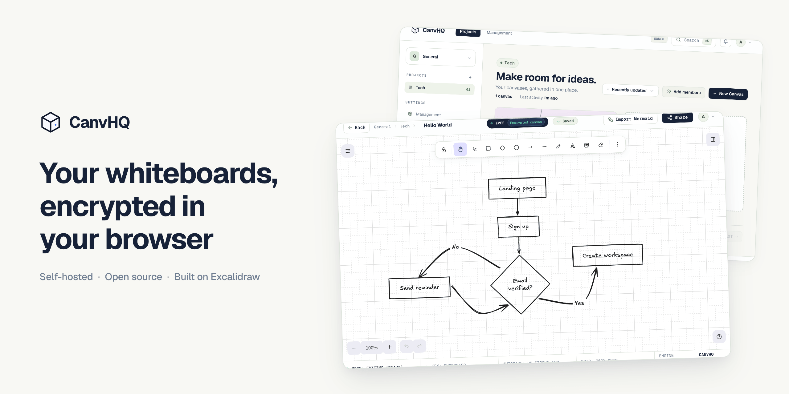

# CanvHQ



A self-hostable whiteboard where canvases are encrypted in your browser before they are saved. It is built on Excalidraw, with workspaces, projects, members and roles around it. Free and open source.

**[Try the demo](https://canvhq-demo.quore.dev)**: one click, no sign-up. Accounts are throwaway, so do not keep real work there.

## Run it on your machine

You need Docker.

```bash
cp .env.example .env
# in .env set AUTH_SECRET (for example `openssl rand -hex 32`) and ENABLE_DEV_LOGIN=true
docker compose up
```

Open http://localhost:5173. The dev login gives you a one-click account, so you do not need a sign-in provider to look around. You set a passphrase the first time you sign in.

That stack is for development: it has hot reload, a local S3-compatible store and relaxed request limits. `.env.example` lists every setting you can change.

## Run it for real

Use `docker-compose.prod.yml` (or `docker-compose.coolify.yml` on Coolify), S3-compatible storage and a Google sign-in client. The documentation in the app, under `/docs`, covers it from there: Docker Compose, Coolify, signing in with Google, a server behind a proxy, storage, backups and restore, upgrading, and every setting.

## What is and is not encrypted

- Encrypted in the browser, with no key on the server that opens them: canvas content and images.
- Stored as readable data: names of workspaces, projects and canvases, member names and emails, and who belongs to what.
- There is no passphrase reset. If someone loses their passphrase, their canvases cannot be opened.
- The encrypting happens in your browser, using code the server sends to it. If that server were compromised or run by someone malicious, it could send your browser altered code. Your own computer or browser being compromised is a limit too. Details and the other limits are on the Security page and in [SECURITY.md](SECURITY.md).

## Limits today

- One person edits a canvas at a time: there is no live multi-user editing yet.
- Sign-in is through Google only. There are no passwords and no email sending: invitations are links you copy.

## Working on it

`backend/` (NestJS, Prisma, PostgreSQL) and `frontend/` (React, Vite) are separate packages with their own `package.json` and lockfile. See [CONTRIBUTING.md](CONTRIBUTING.md). Issues labelled [good first issue](https://github.com/qaribhaider/canvhq/labels/good%20first%20issue) are a good place to start.

## Licence

Apache License 2.0, see [LICENSE](LICENSE) and [NOTICE](NOTICE). The app lists the licences of its dependencies at `/THIRD_PARTY_LICENSES.txt`.
